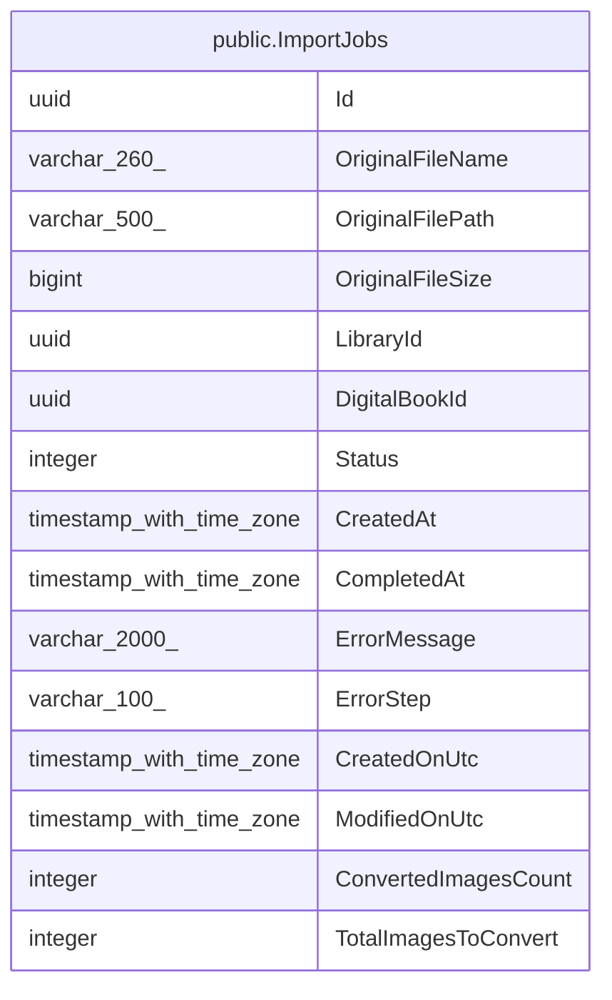

# public.ImportJobs

## Description

Traitement d'import d'un fichier de BD numérique déposé, suivi étape par étape jusqu'à la création du livre numérique.

## Columns

| Name                 | Type                     | Default | Nullable | Children | Parents | Comment                                                                                                                                                                                                                                                                                                    |
| -------------------- | ------------------------ | ------- | -------- | -------- | ------- | ---------------------------------------------------------------------------------------------------------------------------------------------------------------------------------------------------------------------------------------------------------------------------------------------------------- |
| Id                   | uuid                     |         | false    |          |         |                                                                                                                                                                                                                                                                                                            |
| OriginalFileName     | varchar(260)             |         | false    |          |         | Nom du fichier déposé.                                                                                                                                                                                                                                                                                     |
| OriginalFilePath     | varchar(500)             |         | false    |          |         | Chemin du fichier déposé ; unique tant que l'import n'est ni terminé ni en échec.                                                                                                                                                                                                                          |
| OriginalFileSize     | bigint                   |         | false    |          |         | Taille du fichier déposé, en octets.                                                                                                                                                                                                                                                                       |
| LibraryId            | uuid                     |         | false    |          |         | Bibliothèque de destination de l'import.                                                                                                                                                                                                                                                                   |
| DigitalBookId        | uuid                     |         | true     |          |         | Livre numérique créé par l'import ; renseigné une fois l'import terminé.                                                                                                                                                                                                                                   |
| Status               | integer                  |         | false    |          |         | Étape de l'import : 0 = En attente, 1 = Extraction des images de l'archive/PDF, 2 = Conversion des images en WebP, 3 = Recherche de métadonnées (Bedetheque) et mise à jour de ComicInfo.xml, 4 = Envoi de la couverture sur Cloudinary, 5 = Construction de l'archive CBZ finale, 6 = Terminé, 7 = Échec. |
| CreatedAt            | timestamp with time zone |         | false    |          |         | Date de création de l'import.                                                                                                                                                                                                                                                                              |
| CompletedAt          | timestamp with time zone |         | true     |          |         | Date de fin de l'import réussi.                                                                                                                                                                                                                                                                            |
| ErrorMessage         | varchar(2000)            |         | true     |          |         | Message d'erreur en cas d'échec.                                                                                                                                                                                                                                                                           |
| ErrorStep            | varchar(100)             |         | true     |          |         | Étape à laquelle l'import a échoué.                                                                                                                                                                                                                                                                        |
| CreatedOnUtc         | timestamp with time zone |         | false    |          |         |                                                                                                                                                                                                                                                                                                            |
| ModifiedOnUtc        | timestamp with time zone |         | true     |          |         |                                                                                                                                                                                                                                                                                                            |
| ConvertedImagesCount | integer                  | 0       | false    |          |         | Nombre d'images déjà converties (progression de la conversion).                                                                                                                                                                                                                                            |
| TotalImagesToConvert | integer                  | 0       | false    |          |         | Nombre total d'images à convertir.                                                                                                                                                                                                                                                                         |

## Constraints

| Name          | Type        | Definition         |
| ------------- | ----------- | ------------------ |
| PK_ImportJobs | PRIMARY KEY | PRIMARY KEY ("Id") |

## Indexes

| Name                           | Definition                                                                                                                                         |
| ------------------------------ | -------------------------------------------------------------------------------------------------------------------------------------------------- |
| PK_ImportJobs                  | CREATE UNIQUE INDEX "PK_ImportJobs" ON public."ImportJobs" USING btree ("Id")                                                                      |
| IX_ImportJobs_LibraryId        | CREATE INDEX "IX_ImportJobs_LibraryId" ON public."ImportJobs" USING btree ("LibraryId")                                                            |
| IX_ImportJobs_Status           | CREATE INDEX "IX_ImportJobs_Status" ON public."ImportJobs" USING btree ("Status")                                                                  |
| IX_ImportJobs_OriginalFilePath | CREATE UNIQUE INDEX "IX_ImportJobs_OriginalFilePath" ON public."ImportJobs" USING btree ("OriginalFilePath") WHERE ("Status" <> ALL (ARRAY[6, 7])) |

## Relations

---

> Generated by [tbls](https://github.com/k1LoW/tbls)
