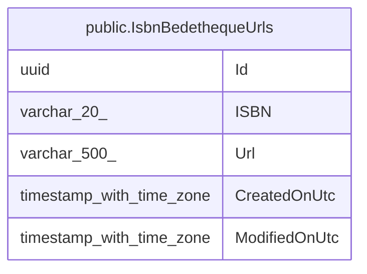

# public.IsbnBedethequeUrls

## Description

Cache de l'URL de la fiche Bedetheque associée à un ISBN.

## Columns

| Name          | Type                     | Default | Nullable | Children | Parents | Comment                                    |
| ------------- | ------------------------ | ------- | -------- | -------- | ------- | ------------------------------------------ |
| Id            | uuid                     |         | false    |          |         |                                            |
| ISBN          | varchar(20)              |         | false    |          |         | ISBN recherché (unique).                   |
| Url           | varchar(500)             |         | false    |          |         | URL de la fiche Bedetheque correspondante. |
| CreatedOnUtc  | timestamp with time zone |         | false    |          |         |                                            |
| ModifiedOnUtc | timestamp with time zone |         | true     |          |         |                                            |

## Constraints

| Name                  | Type        | Definition         |
| --------------------- | ----------- | ------------------ |
| PK_IsbnBedethequeUrls | PRIMARY KEY | PRIMARY KEY ("Id") |

## Indexes

| Name                       | Definition                                                                                           |
| -------------------------- | ---------------------------------------------------------------------------------------------------- |
| PK_IsbnBedethequeUrls      | CREATE UNIQUE INDEX "PK_IsbnBedethequeUrls" ON public."IsbnBedethequeUrls" USING btree ("Id")        |
| IX_IsbnBedethequeUrls_ISBN | CREATE UNIQUE INDEX "IX_IsbnBedethequeUrls_ISBN" ON public."IsbnBedethequeUrls" USING btree ("ISBN") |

## Relations

---

> Generated by [tbls](https://github.com/k1LoW/tbls)
