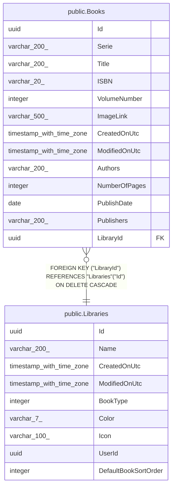

# public.Libraries

## Description

Bibliothèque d'un utilisateur, qui regroupe uniquement des BD physiques ou uniquement des BD numériques.

## Columns

| Name                 | Type                     | Default                                      | Nullable | Children                        | Parents | Comment                                                                                                                                         |
| -------------------- | ------------------------ | -------------------------------------------- | -------- | ------------------------------- | ------- | ----------------------------------------------------------------------------------------------------------------------------------------------- |
| Id                   | uuid                     |                                              | false    | [public.Books](public.Books.md) |         |                                                                                                                                                 |
| Name                 | varchar(200)             |                                              | false    |                                 |         | Nom de la bibliothèque (il sert aussi à déterminer son dossier de stockage pour les BD numériques).                                             |
| CreatedOnUtc         | timestamp with time zone |                                              | false    |                                 |         |                                                                                                                                                 |
| ModifiedOnUtc        | timestamp with time zone |                                              | true     |                                 |         |                                                                                                                                                 |
| BookType             | integer                  | 0                                            | false    |                                 |         | Type de BD contenues : 0 = Physique, 1 = Numérique.                                                                                             |
| Color                | varchar(7)               | ''::character varying                        | false    |                                 |         |                                                                                                                                                 |
| Icon                 | varchar(100)             | ''::character varying                        | false    |                                 |         |                                                                                                                                                 |
| UserId               | uuid                     | '00000000-0000-0000-0000-000000000000'::uuid | false    |                                 |         | Identifiant de l'utilisateur propriétaire de la bibliothèque.                                                                                   |
| DefaultBookSortOrder | integer                  | 0                                            | false    |                                 |         | Tri par défaut des livres : 0 = Plus récents d'abord (Id décroissant), 1 = Plus anciens d'abord (Id croissant), 2 = Série puis tome croissants. |

## Constraints

| Name         | Type        | Definition         |
| ------------ | ----------- | ------------------ |
| PK_Libraries | PRIMARY KEY | PRIMARY KEY ("Id") |

## Indexes

| Name         | Definition                                                                  |
| ------------ | --------------------------------------------------------------------------- |
| PK_Libraries | CREATE UNIQUE INDEX "PK_Libraries" ON public."Libraries" USING btree ("Id") |

## Relations

---

> Generated by [tbls](https://github.com/k1LoW/tbls)
