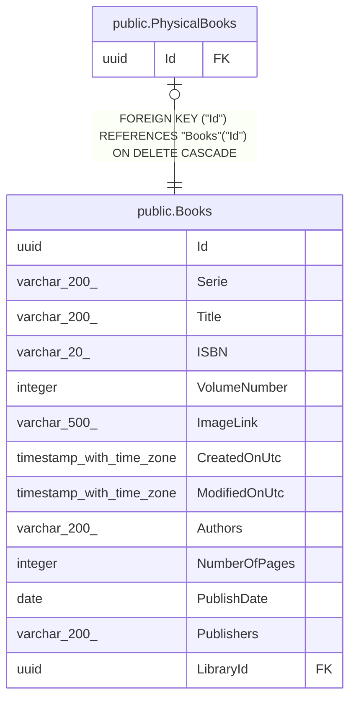

# public.PhysicalBooks

## Description

Spécialisation d'un livre physique (possédé sur papier) ; même Id que la ligne de Books, sans colonne propre.

## Columns

| Name | Type | Default | Nullable | Children | Parents                         | Comment |
| ---- | ---- | ------- | -------- | -------- | ------------------------------- | ------- |
| Id   | uuid |         | false    |          | [public.Books](public.Books.md) |         |

## Constraints

| Name                      | Type        | Definition                                                    |
| ------------------------- | ----------- | ------------------------------------------------------------- |
| FK_PhysicalBooks_Books_Id | FOREIGN KEY | FOREIGN KEY ("Id") REFERENCES "Books"("Id") ON DELETE CASCADE |
| PK_PhysicalBooks          | PRIMARY KEY | PRIMARY KEY ("Id")                                            |

## Indexes

| Name             | Definition                                                                          |
| ---------------- | ----------------------------------------------------------------------------------- |
| PK_PhysicalBooks | CREATE UNIQUE INDEX "PK_PhysicalBooks" ON public."PhysicalBooks" USING btree ("Id") |

## Relations

---

> Generated by [tbls](https://github.com/k1LoW/tbls)
