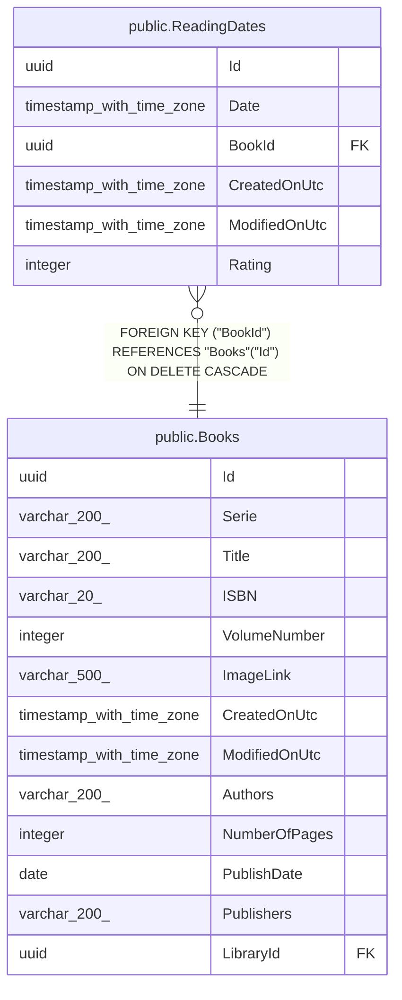

# public.ReadingDates

## Description

Lecture d'un livre par l'utilisateur, avec la note donnée à cette occasion.

## Columns

| Name          | Type                     | Default | Nullable | Children | Parents                         | Comment                                      |
| ------------- | ------------------------ | ------- | -------- | -------- | ------------------------------- | -------------------------------------------- |
| Id            | uuid                     |         | false    |          |                                 |                                              |
| Date          | timestamp with time zone |         | false    |          |                                 | Date de la lecture.                          |
| BookId        | uuid                     |         | false    |          | [public.Books](public.Books.md) | Livre lu.                                    |
| CreatedOnUtc  | timestamp with time zone |         | false    |          |                                 |                                              |
| ModifiedOnUtc | timestamp with time zone |         | true     |          |                                 |                                              |
| Rating        | integer                  | 0       | false    |          |                                 | Note donnée lors de cette lecture, de 1 à 5. |

## Constraints

| Name                         | Type        | Definition                                                        |
| ---------------------------- | ----------- | ----------------------------------------------------------------- |
| FK_ReadingDates_Books_BookId | FOREIGN KEY | FOREIGN KEY ("BookId") REFERENCES "Books"("Id") ON DELETE CASCADE |
| PK_ReadingDates              | PRIMARY KEY | PRIMARY KEY ("Id")                                                |

## Indexes

| Name                   | Definition                                                                            |
| ---------------------- | ------------------------------------------------------------------------------------- |
| PK_ReadingDates        | CREATE UNIQUE INDEX "PK_ReadingDates" ON public."ReadingDates" USING btree ("Id")     |
| IX_ReadingDates_BookId | CREATE INDEX "IX_ReadingDates_BookId" ON public."ReadingDates" USING btree ("BookId") |

## Relations

---

> Generated by [tbls](https://github.com/k1LoW/tbls)
