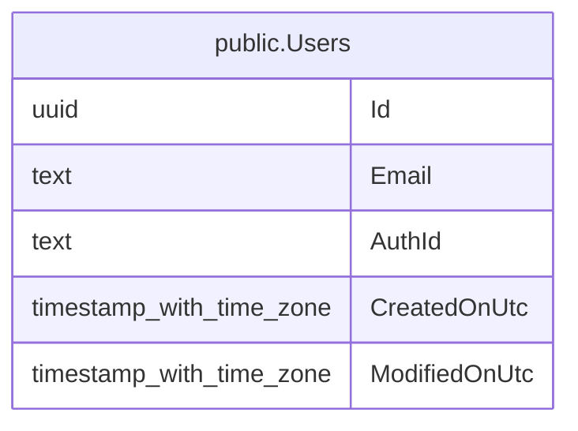

# public.Users

## Description

Utilisateur de l'application.

## Columns

| Name          | Type                     | Default | Nullable | Children | Parents | Comment                                                              |
| ------------- | ------------------------ | ------- | -------- | -------- | ------- | -------------------------------------------------------------------- |
| Id            | uuid                     |         | false    |          |         |                                                                      |
| Email         | text                     |         | false    |          |         |                                                                      |
| AuthId        | text                     |         | false    |          |         | Identifiant de l'utilisateur chez le fournisseur d'authentification. |
| CreatedOnUtc  | timestamp with time zone |         | false    |          |         |                                                                      |
| ModifiedOnUtc | timestamp with time zone |         | true     |          |         |                                                                      |

## Constraints

| Name     | Type        | Definition         |
| -------- | ----------- | ------------------ |
| PK_Users | PRIMARY KEY | PRIMARY KEY ("Id") |

## Indexes

| Name     | Definition                                                          |
| -------- | ------------------------------------------------------------------- |
| PK_Users | CREATE UNIQUE INDEX "PK_Users" ON public."Users" USING btree ("Id") |

## Relations

---

> Generated by [tbls](https://github.com/k1LoW/tbls)
